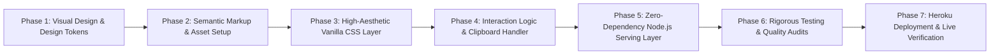

# Syntavex — Phased Implementation Plan

This plan outlines the sequenced, step-by-step implementation roadmap for building, verifying, and deploying the Syntavex web presence once this discovery specification receives owner approval.

---

## Phase Overview & Dependency Chain

---

## Phase Breakdown

### Phase 1: Visual Design & Token Definition
* **Goal**: Establish a distinctive, state-of-the-art aesthetic using the `frontend-design` skill.
* **Tasks**:
  1. Define curated color palette: deep obsidian background (`#08090d` / `#0d0f17`), neon cyan/violet accents, crisp text contrast.
  2. Select modern typography via Google Fonts (e.g., `Inter` or `Space Grotesk` / `Outfit` with high-performance `display=swap`).
  3. Formulate CSS custom properties (tokens) for spacing, typography, radii, shadows, and glassmorphic blur filters.
  4. Design clean vector SVG emblem and favicon for Syntavex.

### Phase 2: Semantic HTML Markup & Page Structure
* **Goal**: Construct clean, accessible HTML5 skeleton adhering to [`docs/product/PAGE_SPECIFICATIONS.md`](file:///e:/startup/Syntavex/docs/product/PAGE_SPECIFICATIONS.md).
* **Tasks**:
  1. Author `public/index.html` with complete metadata, OpenGraph tags, and semantic landmark elements.
  2. Implement all sections: Header/Navbar, Hero, Capabilities, Architecture, Tech Stack, Process, Labs Teaser, Contact Hub, and Footer.
  3. Ensure all interactive elements have unique, descriptive IDs and proper ARIA labels.

### Phase 3: High-Aesthetic Vanilla CSS Implementation
* **Goal**: Style the application to deliver an immediate "WOW" visual impression without heavy external frameworks.
* **Tasks**:
  1. Implement modern reset, typography hierarchy, and fluid CSS grid/flexbox layouts in `public/css/main.css`.
  2. Style cards with ambient border glows, backdrop filters, and subtle hover lifts.
  3. Create responsive breakpoints for mobile (320px–480px), tablet (768px–1024px), and desktop (1200px+).
  4. Ensure WCAG 2.2 AA compliant contrast across all elements.

### Phase 4: Client Logic & Micro-Interactions
* **Goal**: Provide smooth, reactive browser interactions in `public/js/app.js`.
* **Tasks**:
  1. Implement robust 1-click clipboard copy for `contact@syntavex.com` with toast state feedback and legacy fallback.
  2. Add active scroll spy and navbar background blur trigger via `IntersectionObserver`.
  3. Implement accessible mobile navigation toggle menu.
  4. Ensure zero external script dependencies.

### Phase 5: Zero-Dependency Serving Runtime & Heroku Prep
* **Goal**: Package the site for instant deployment to the founder's existing Heroku plan.
* **Tasks**:
  1. Author lightweight `server.js` using Node.js built-in `http` and `fs` modules with dynamic `$PORT` binding.
  2. Configure automatic injection of security headers (CSP, X-Frame-Options, X-Content-Type-Options).
  3. Create standard `package.json` with `"start": "node server.js"`.
  4. Configure `Procfile` (`web: node server.js`).

### Phase 6: Automated Testing, Performance & Quality Verification
* **Goal**: Validate every acceptance criterion in [`docs/product/ACCEPTANCE_CRITERIA.md`](file:///e:/startup/Syntavex/docs/product/ACCEPTANCE_CRITERIA.md) before deployment.
* **Tasks**:
  1. Execute automated browser tests with Playwright (verifying layout, navigation links, clipboard copy behavior, and responsive breakpoints).
  2. Run automated accessibility audit (zero high/critical violations).
  3. Run Google Lighthouse audit (verify scores $\ge 95$ across Performance, Accessibility, Best Practices, and SEO).
  4. Inspect console logs to guarantee zero errors or unhandled warnings.

### Phase 7: Deployment & Final Handoff
* **Goal**: Deploy to Heroku and verify live functionality.
* **Tasks**:
  1. Initialize Heroku git remote or provide automated CLI deployment commands.
  2. Verify live SSL, header security, and mobile rendering in production.
  3. Document post-launch maintenance notes under `docs/deployment/HEROKU_DEPLOYMENT.md`.
