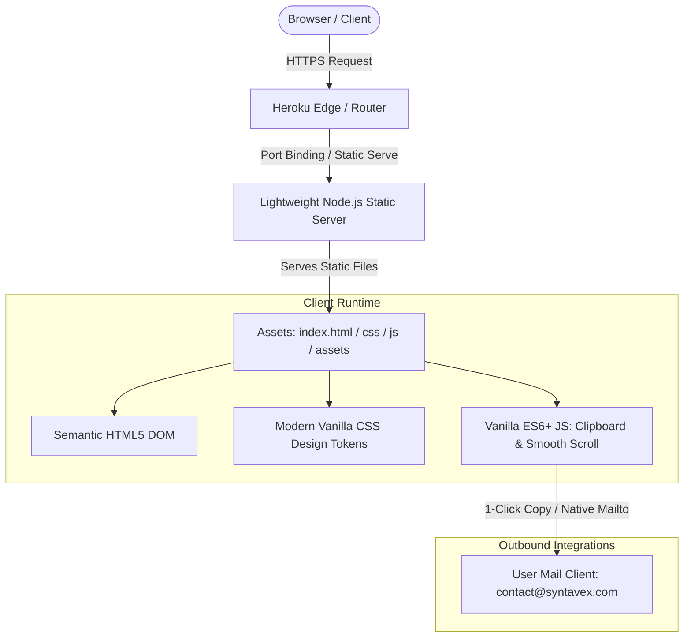

# Syntavex — Technical Architecture & Deployment Specification

This document details the software architecture, runtime environment, deployment pipeline, and performance standards for the Syntavex web presence.

---

## 1. System Architecture Diagram



---

## 2. Technology Stack & Rationale

| Layer | Selected Technology | Technical Rationale |
|---|---|---|
| **Structure** | Semantic HTML5 | Zero build overhead, native SEO accessibility tags, landmark elements (`header`, `main`, `section`, `footer`). |
| **Styling** | Modern Vanilla CSS3 | Custom CSS variables (design tokens), flexbox/grid layouts, zero CSS bundle bloat, native animations and glassmorphism. |
| **Client Logic** | Vanilla ES6+ JavaScript | No heavy framework runtime, zero virtual DOM overhead, native browser APIs (`navigator.clipboard`, `IntersectionObserver`). |
| **Serving Runtime** | Node.js (Built-in `http` / zero-dependency) | Binds to `$PORT` required by Heroku, serves static files with correct MIME types and security headers. No vulnerable dependencies. |
| **Hosting Platform** | Heroku (Existing 2-year $13/mo subscription) | Pre-paid compute resource; deployed via Git push to Heroku remote. |

---

## 3. Directory & File Structure

```text
Syntavex/
├── .agents/                    # Agent skills and workflow configurations
├── docs/                       # Project documentation
│   ├── product/                # Product discovery & specifications
│   │   ├── PROJECT_BRIEF.md
│   │   ├── DECISIONS.md
│   │   ├── USER_ROLES.md
│   │   ├── FEATURE_CATALOG.md
│   │   ├── USER_FLOWS.md
│   │   ├── PAGE_SPECIFICATIONS.md
│   │   ├── TECHNICAL_ARCHITECTURE.md
│   │   ├── SECURITY_REQUIREMENTS.md
│   │   ├── ACCEPTANCE_CRITERIA.md
│   │   └── IMPLEMENTATION_PLAN.md
│   ├── architecture/
│   ├── testing/
│   └── deployment/
├── public/                     # Static assets served by runtime
│   ├── index.html              # Main single-page application markup
│   ├── css/
│   │   └── main.css            # Design tokens, typography, layout, animations
│   ├── js/
│   │   └── app.js              # Interaction handlers, clipboard copy, scroll observers
│   └── assets/
│       ├── favicon.svg         # Modern vector favicon
│       └── og-preview.png      # Social preview metadata card
├── server.js                   # Minimal zero-dependency Node.js HTTP static server
├── package.json                # Project manifest with start script ("node server.js")
└── Procfile                    # Heroku process definition ("web: node server.js")
```

---

## 4. Serving Runtime & Header Configuration

The lightweight `server.js` serves assets from `/public` and automatically injects recommended security headers:
* `Content-Security-Policy`: Restricts scripts, styles, and frames to origin.
* `X-Frame-Options: DENY`: Prevents clickjacking.
* `X-Content-Type-Options: nosniff`: Prevents MIME-sniffing.
* `Referrer-Policy: strict-origin-when-cross-origin`: Protects referrer headers.
* `Cache-Control: public, max-age=3600`: Efficient caching while enabling rapid content updates.

---

## 5. Performance Budgets

| Metric | Target Budget | Measurement Method |
|---|---|---|
| **Lighthouse Performance** | $\ge 95$ / 100 | Google Lighthouse CI / DevTools |
| **Lighthouse Accessibility** | $\ge 95$ / 100 | Google Lighthouse CI / DevTools |
| **Lighthouse Best Practices** | 100 / 100 | Google Lighthouse CI / DevTools |
| **Lighthouse SEO** | 100 / 100 | Google Lighthouse CI / DevTools |
| **First Contentful Paint (FCP)** | $< 0.8\text{s}$ | Chrome DevTools Core Web Vitals |
| **Largest Contentful Paint (LCP)** | $< 1.2\text{s}$ | Chrome DevTools Core Web Vitals |
| **Cumulative Layout Shift (CLS)** | $< 0.05$ | Chrome DevTools Core Web Vitals |
| **Total Page Weight** | $< 250\text{ KB}$ | Network tab payload inspection |
