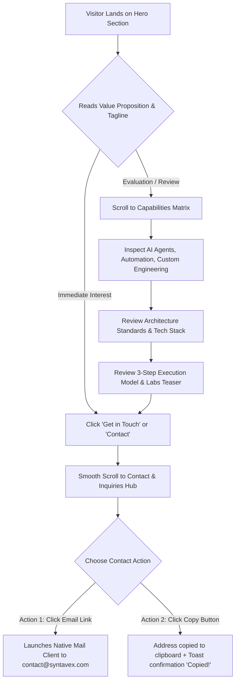
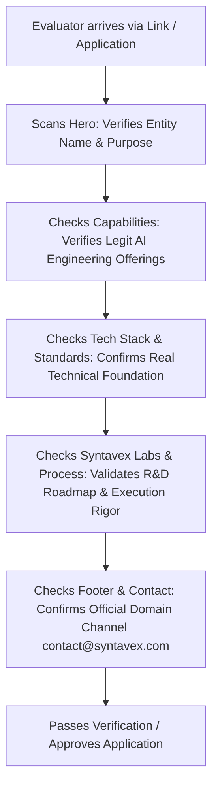

# Syntavex — User Flows & Journeys

This document models the visitor pathways on the Syntavex website, detailing how visitors consume content, evaluate engineering credibility, and execute contact actions.

---

## 1. Primary Evaluation & Inbound Contact Flow

---

## 2. Reviewer Journey: Startup Benefit Evaluator / Recruiter

---

## 3. Micro-Interaction & Error Handling Flows

### 1-Click Clipboard Copy Flow
1. User clicks the **"Copy Email"** button next to `contact@syntavex.com`.
2. Script invokes modern `navigator.clipboard.writeText('contact@syntavex.com')`.
3. If modern clipboard API is available:
   - Button UI dynamically transitions to a checkmark state with text *"Copied to clipboard!"*.
   - Reverts back to initial state after 2.5 seconds.
4. Fallback if clipboard API is restricted by browser security:
   - Script gracefully falls back to `document.execCommand('copy')` or highlights the text with prompt to copy manually.
   - Zero console errors or broken states.

### Responsive Viewport Handling
* Seamless scaling across mobile (320px–480px), tablet (768px–1024px), and desktop/wide displays (1200px+).
* Mobile navigation menu with clean toggle drawer or sticky quick-action bar.
